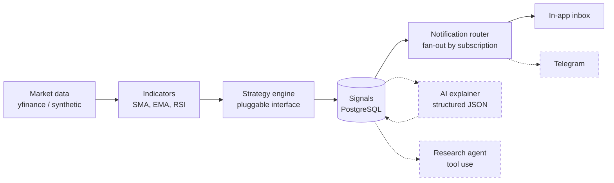
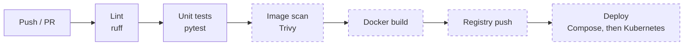

# SignalForge_AI


A signal pipeline for Indian indices, gold and Bitcoin. A strategy engine produces signals, a router delivers each one only to the users who follow that asset, and (next) an AI layer explains every signal and answers questions about it through tool use.

> **Educational project. Not investment advice.** Signals come from a placeholder strategy and are not recommendations.

## Architecture

Solid boxes are built (Phase 1). Dashed boxes are planned and shown in the roadmap below.



Design choices:

- **Deterministic core, AI on top.** Strategies decide when a signal fires. The AI layer only explains and investigates signals that already exist, so it cannot invent them.
- **One signal, many recipients.** A signal is created once per asset and fanned out to subscribers, so cost does not grow with user count.
- **Idempotent runs.** Each signal has a dedupe key (asset, strategy, direction, bar), so re-running the pipeline never duplicates signals or notifications.
- **Pluggable channels and strategies.** Adding Telegram means registering one more channel handler. Adding a strategy means one new class.
- **Failure isolation.** If the data source fails for one asset, the others still run.

## Quickstart

### 1. Offline demo (no database, no network)

```bash
python -m venv .venv
source .venv/bin/activate          # Windows PowerShell: .venv\Scripts\Activate.ps1
pip install pandas numpy
python -m app.cli demo
```

This replays synthetic market history through the full pipeline. Sample output:

```text
2025-12-05  SENSEX     BEARISH  price=  77963.94  rsi=37.5258  -> 1 notification(s)
2026-01-15  NIFTY      BEARISH  price=  27488.85  rsi=36.5271  -> 2 notification(s)
2026-02-02  BANKNIFTY  BULLISH  price=  46973.71  rsi=53.1793  -> 1 notification(s)
...
17 signals created. Inbox per user (each user only gets what they follow):
  alice  follows ['NIFTY', 'BITCOIN'] -> 9 notifications, received for ['BITCOIN', 'NIFTY']
  bob    follows ['GOLD', 'SENSEX', 'BITCOIN'] -> 9 notifications, received for ['BITCOIN', 'GOLD', 'SENSEX']
  carol  follows ['BANKNIFTY', 'NIFTY'] -> 8 notifications, received for ['BANKNIFTY', 'NIFTY']
```

### 2. Full stack with Docker Compose

```bash
docker compose up --build
```

Starts PostgreSQL, a one-shot init job (tables, demo users, demo signals), the API and the scheduled worker. Open http://localhost:8000/docs, then try `GET /signals` and `GET /users/1/notifications`.

### 3. API locally with SQLite

```bash
pip install -r requirements.txt
python -m app.cli init-db --with-demo-signals
uvicorn app.api:create_app --factory --reload
```

Set `DATA_PROVIDER=yfinance` (see `.env.example`) to use live daily prices instead of synthetic data.

### Tests and lint

```bash
pip install -r requirements-dev.txt
pytest
ruff check .
```

## API

| Method | Path | Purpose |
|---|---|---|
| GET | `/health` | Liveness check |
| GET | `/assets` | The tracked assets |
| GET | `/signals?asset=` | Recent signals |
| GET | `/users/{id}/subscriptions` | Assets a user follows |
| PUT / DELETE | `/users/{id}/subscriptions/{asset}` | Follow or unfollow, with channels |
| GET | `/users/{id}/notifications` | A user's inbox |
| POST | `/pipeline/run` | Run one pipeline pass on demand |

There is no login in Phase 1. Three demo users are pre-seeded and the user id is part of the URL.

## Add a strategy

```python
# app/strategies.py
class MyStrategy(Strategy):
    name = "my_strategy"

    def evaluate(self, asset, prices):
        ...  # return a Signal for the latest bar, or None
```

Add it to `default_strategies()` and it runs for every asset, with storage, deduplication and notification already handled.

## Project layout

```text
app/
  assets.py        tracked assets and their tickers
  market_data.py   yfinance and synthetic providers
  indicators.py    SMA, EMA, RSI
  strategies.py    Strategy interface + placeholder crossover
  pipeline.py      fetch -> evaluate -> store -> notify
  notify.py        channel handlers and fan-out router
  repository.py    storage interface + in-memory implementation
  db/              SQLAlchemy models, repository, seed data
  api.py           FastAPI app
  worker.py        scheduled pipeline runner
  cli.py           demo, init-db, run-once
tests/             unit tests (API tests skip if web deps are missing)
```

## Roadmap

| Phase | Scope | Status |
|---|---|---|
| 1 | Data, indicators, pluggable strategies, signal storage, subscription fan-out, API, Docker Compose | Done |
| 2 | **AI explainer:** each signal gets a structured JSON explanation (why it fired, key levels, risks) generated from stored indicator data | Planned |
| 3 | **Research agent:** tool-using agent over signal history, indicators and news ("why is Bitcoin flagged but Gold isn't?") | Planned |
| 4 | Telegram delivery, live in-app push, per-user quiet hours and digests | Planned |
| 5 | **CI/CD:** security scan, image build and push, automated deploy (lint and tests already run on every push) | In progress |
| 6 | Observability: Prometheus and Grafana for signals, delivery latency, LLM cost per run | Planned |
| Later | User accounts and login, personalised strategies, cloud deployment | Planned |

### Planned AI layer

- **Explainer:** receives only structured data (price, indicators, recent move) and must return JSON that matches a schema, which is validated before it is stored.
- **Agent tools:** query signal history, compare assets, fetch indicators, fetch recent news. The agent chooses which tools to call and cites the data it used.
- **Testing:** LLM calls are mocked in CI, so tests are free and deterministic.

### Planned CI/CD pipeline



Lint and tests run today in `.github/workflows/ci.yml`. Dashed stages are next.
